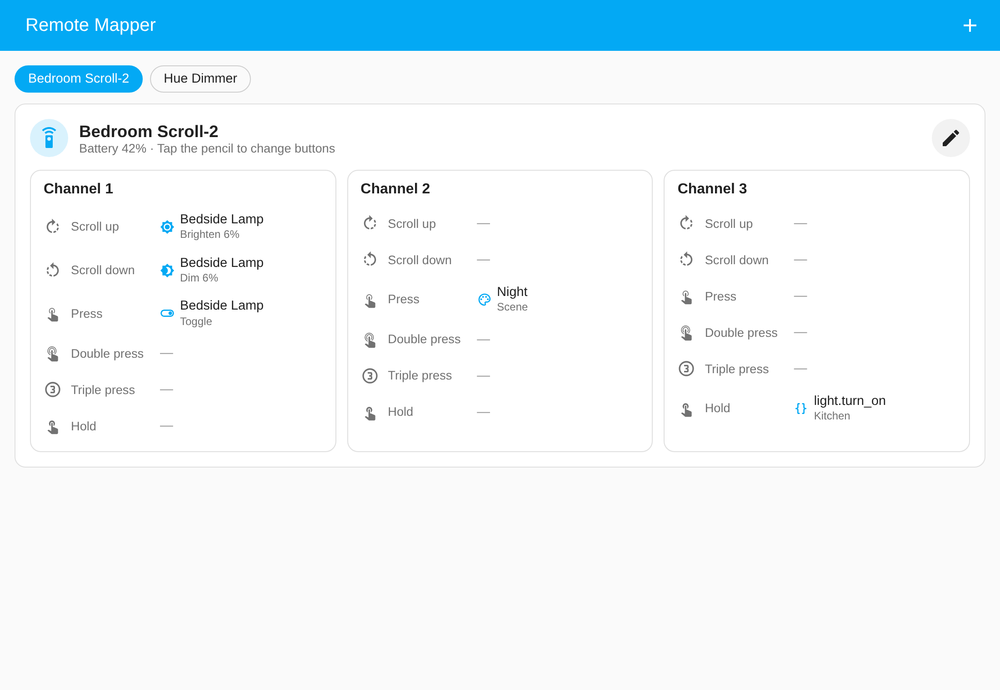
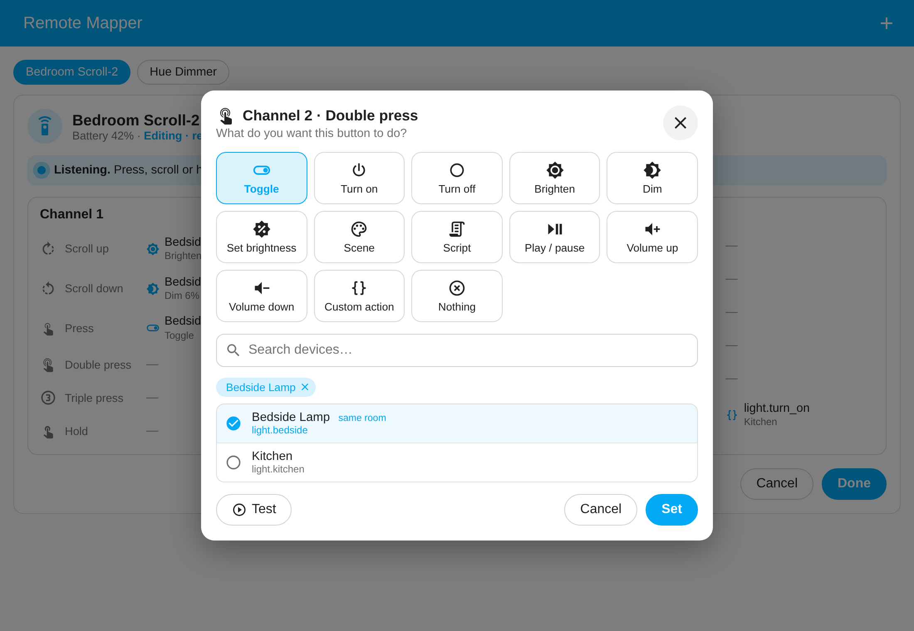

# Remote Mapper for Home Assistant

[](https://hacs.xyz/docs/faq/custom_repositories)
[](https://github.com/correctweightmate/ha-remote-mapper/actions/workflows/validate.yml)
[](https://github.com/correctweightmate/ha-remote-mapper/releases)

**Set up a remote by pressing its buttons.** Tap the pencil, press a button on the remote, pick what it should do, then tap **Done**. You don't need YAML, blueprints or one automation per button.





## Features

- **Press-to-assign.** While you're editing, the remote is paused and every press opens a "What should this button do?" popup for that exact button and gesture.
- **Works with any remote that has `event` entities.** That covers Matter, Philips Hue, Zigbee2MQTT/MQTT event entities and more. Each button becomes a group with one slot per event type it reports.
- **Dedicated layouts.** The **IKEA BILRESA scroll wheel** gets 3 channels, each with scroll up, scroll down, press, double press, triple press and hold. Scroll actions scale with how far you turn the wheel.
- **Actions:** toggle, turn on, turn off, brighten, dim, set brightness, scene, script, play/pause, volume up/down, or a **custom action** (any Home Assistant action with JSON data). Each one has a **Test** button.
- Brighten turns an off light on. Dim never switches a light off (it stops at 1%).
- A **sidebar panel** for admins, plus a **Lovelace card** (`custom:remote-mapper-card`) for any dashboard.
- Each press also fires a **`remote_mapper_button`** event, so you can still build your own automations.
- An **edit-mode switch** per remote. It turns itself off after a period of inactivity (10 min by default), so a remote can't be left paused forever.
- Runs 100% locally. No cloud, no extra dependencies.

## Install

### HACS (recommended)

1. Click the button below, or in HACS go to **⋮ → Custom repositories**, add `https://github.com/correctweightmate/ha-remote-mapper` and choose type **Integration**.

   [](https://my.home-assistant.io/redirect/hacs_repository/?owner=correctweightmate&repository=ha-remote-mapper&category=integration)

2. Download **Remote Mapper**, then **restart Home Assistant**.

### Manual

Copy `custom_components/remote_mapper` into your `config/custom_components/` folder and restart Home Assistant.

## Set up

1. Click the button below, or go to **Settings → Devices & services → Add integration → Remote Mapper**:

   [](https://my.home-assistant.io/redirect/config_flow_start/?domain=remote_mapper)

2. Pick your remote. Only devices with button (event) entities are listed. Add the integration again for each remote you have.
3. Open **Remote Mapper** in the sidebar and tap the ✏️ pencil.
4. Press, scroll or hold a button on the remote (on a BILRESA, pick the channel first). You can also tap a slot on screen.
5. Choose an action and the devices, tap **Test** if you like, then tap **Set**.
6. When you've finished, tap **Done**. The remote works straight away.

## Lovelace card

```yaml
type: custom:remote-mapper-card
# entry_id: 01J...   # optional – omit to show every remote as tabs
```

The card is loaded automatically, so you don't need to add a resource. You can also add it from the card picker (search for "Remote Mapper"). Only admins can edit; everyone else sees the card read-only.

## Options

Go to **Settings → Devices & services → Remote Mapper → Configure**.

| Option | Default | What it does |
| --- | --- | --- |
| Button layout | Automatic | Uses a dedicated layout when one exists for the model, otherwise generic. Switching layouts drops mappings for slots the new layout doesn't have. |
| Edit mode turns itself off after | 600 s | How long editing can sit idle before the remote goes back to normal. If the editor has unsaved changes at that point, it saves them. |

## Using presses in your own automations

Every recognised press (when you're not editing) fires an event:

```yaml
triggers:
  - trigger: event
    event_type: remote_mapper_button
    event_data:
      slot: ch1_double        # BILRESA layout; generic layout slots look like "<registry id>:<event type>"
actions:
  - action: notify.notify
    data:
      message: "Pressed {{ trigger.event.data.slot_label }} on {{ trigger.event.data.device_id }}"
```

Event data: `entry_id`, `device_id`, `slot`, `slot_label`, `n` (scroll detents, 1 for presses), `event_type`, `entity_id`, `mapped`.

## Supported remotes

| Remote | Layout |
| --- | --- |
| IKEA BILRESA scroll wheel (Matter) | Dedicated: 3 channels × 6 gestures, scroll steps scale with detents |
| Anything else with `event` entities (Hue dimmers and tap dials, Matter switches, Z2M event entities, …) | Generic: one group per button, one slot per event type |

Want a dedicated layout for your remote? Open an issue using the **Add a layout for my remote** template and attach the integration's diagnostics.

## How it works

- Button maps are stored in Home Assistant's own storage (`.storage/remote_mapper.<entry_id>`) and included in backups.
- A press counts only when the button entity's state changes to a fresh timestamp. Restored or reconnect states, and duplicates within 250 ms (some remotes double-report), are ignored.
- Mapped actions run one at a time per remote, so scroll steps stay in order. At most 10 can be queued, and each times out after 15 s.
- Custom-action data is passed to the action as plain values. Template syntax is rejected.
- To uninstall, delete the integration entries, then remove the repository in HACS. Deleting an entry also deletes its stored map.

## Troubleshooting

- **Nothing happens in edit mode:** check that the remote's event entities update in **Developer tools → States** when you press a button.
- **Logs:**

  ```yaml
  logger:
    logs:
      custom_components.remote_mapper: debug
  ```

- **Bug reports:** please attach **Download diagnostics** from the integration's ⋮ menu.

## Development

```bash
python -m venv .venv && . .venv/bin/activate
pip install -r requirements_test.txt
python -m pytest -q
```

## License

MIT
